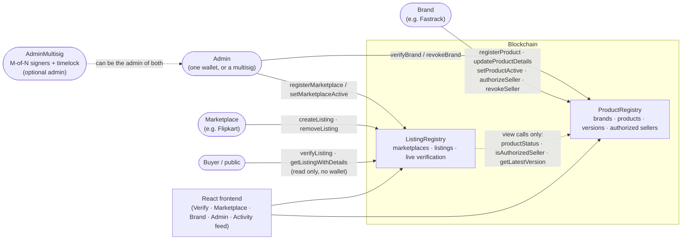

# VeriList

VeriList is a blockchain registry that stops fake and duplicate product listings on online marketplaces.
The brand becomes the single source of truth: it registers its products, their details and its authorized
sellers, and a marketplace can only create a listing if the blockchain confirms the product is real, active,
and the seller is authorized. Anyone can verify any listing live, and the answer changes the moment a brand or
the admin changes something.

Physical counterfeits (QR codes, NFC, delivery scanning), payments and escrow are out of scope.

Documents: [VIVA_GUIDE.md](VIVA_GUIDE.md) (study guide) · [DECISIONS.md](DECISIONS.md) (deviations and judgment calls)

---

## Architecture



Both registries inherit a small hand-written `Ownable` (the owner is the admin). Ownership changes in **two steps**
(the admin offers, the new owner accepts), and the admin can be a **multisig with a timelock** instead of one wallet
(see "Safer admin" below).

---

## Live on Sepolia (public test network)

The contracts are deployed on the **Sepolia** test network, and their source code is **verified on Etherscan**, so anyone
can read it and use the *Read Contract* tab without installing anything. (October 2026, Solidity 0.8.24, optimizer 200 runs.)

| Contract | Address | Etherscan |
|---|---|---|
| `ProductRegistry` | `0x8CDe83A53062Dafa7122B2b268A1C916cD123e14` | [verified code](https://sepolia.etherscan.io/address/0x8CDe83A53062Dafa7122B2b268A1C916cD123e14#code) |
| `ListingRegistry` | `0xEcA6cF8891201C4D83F503c439520Fc9aDFf4C57` | [verified code](https://sepolia.etherscan.io/address/0xEcA6cF8891201C4D83F503c439520Fc9aDFf4C57#code) |

How it was done is in [SEPOLIA_GUIDE.md](SEPOLIA_GUIDE.md). Sepolia ETH is a test coin with no value.

## Prerequisites

- **Node.js 20 or newer** (tested on 24) and npm. Works on Windows, macOS and Linux.
- Nothing else for local use. Python is only needed if you want to run Slither.

## Setup

Run these once, from the project folder:

```bash
npm install
npm run frontend:install
```

## Run the local demo (3 terminals)

**Terminal 1** — start a local blockchain and leave it running:

```bash
npm run node
```

**Terminal 2** — deploy the contracts and fill them with demo data:

```bash
npm run deploy:local && npm run seed:local
```

**Terminal 3** — start the website, then open the address it prints (normally <http://localhost:5173>):

```bash
npm run frontend:dev
```

No wallet is needed in this mode. Use the **"Acting as"** dropdown at the top right to become the Admin, a
brand, a marketplace or a seller.

The demo accounts (Hardhat's default accounts) are:

| # | Role | Account |
|---|---|---|
| 0 | Admin | Admin |
| 1 | Brand | Fastrack |
| 2 | Brand | Titan |
| 3 | Marketplace | Flipkart |
| 4 | Marketplace | Amazon |
| 5 | Seller | RetailNet |
| 6 | Seller | QuickShop |
| 7 | Unauthorized seller | FakeDeals |

The seed creates 3 products (Fastrack Reflex Pro, Fastrack Chroma Analog, Titan Edge Slim), authorizes some
sellers, and creates 3 genuine listings: **#1** Flipkart/Reflex Pro/RetailNet, **#2** Amazon/Reflex
Pro/RetailNet, **#3** Amazon/Chroma Analog/QuickShop. All data is made up.

---

## 5-minute demo script

Start from a **freshly seeded** chain (see the troubleshooting section if you have already clicked around).
Tip: open a second browser tab on `http://localhost:5173/#/verify/1` and keep it visible. It updates by itself
in steps 3 to 5.

**1. Verify a genuine listing**
1. Open the site. The **Verify** tab is the landing page, and you do not need an account.
2. Under *Recent listings*, click **#1 Fastrack Reflex Pro**.
3. Point out the large **Genuine listing** verdict, the five checks (*Listing active → Marketplace active →
   Brand verified → Product active → Seller authorized*, all Pass), the product details (*Version 1 of 1*) and
   the **Integrity check passed** box showing the recalculated hash equals the on-chain hash.

**2. As Flipkart, try to list for FakeDeals: rejected twice**
1. In **Acting as**, choose **Flipkart (marketplace)**. Open the **Marketplace** tab.
2. Product: **Fastrack Reflex Pro — Fastrack**. Seller: **FakeDeals (unauthorized seller)**. Reference: type `FLIP-FAKE-1`.
3. The **pre-check** turns red straight away: *Cannot list: the brand has not authorized this seller for this product.*
4. Click **Try anyway (will be rejected)**. The transaction is rejected too, with a plain sentence:
   *FakeDeals is not authorized by the brand to sell Fastrack Reflex Pro.* Nothing is written to the chain.

**3. As Fastrack, update the details: Flipkart and Amazon both show version 2**
1. In **Acting as**, choose **Fastrack (brand)**. Open the **Brand** tab and scroll to **Fastrack Reflex Pro**.
2. Open **Update details**. Change **MRP** to `3495` and the **battery** spec to `10 days`.
3. Click **Publish new version**. It shows *Confirmed in block N* with the transaction hash, and the Activity
   feed says *Fastrack updated Fastrack Reflex Pro to version 2.*
4. Open the **Verify** tab and click **#1** (Flipkart), then **#2** (Amazon). Both show **Version 2 of 2**,
   MRP ₹3,495 and battery 10 days. The old version is still in *Version history*.

**4. As Fastrack, revoke RetailNet: the listing flips to "Not genuine"**
1. On the **Brand** tab, in *Fastrack Reflex Pro → Authorized sellers*, click **Revoke** next to **RetailNet**.
2. Open **Verify → #1**. The verdict is now **Not genuine**: *The brand does not authorize this seller to sell
   this product*, and the check **Seller authorized** shows **Fail**. Listing #2 (same seller) flips too.
   Listing **#3** (QuickShop) stays genuine. Nobody edited any listing: the answer is worked out live.

**5. Re-authorize RetailNet: the listing flips back**
1. On the **Brand** tab, under *Authorized sellers*, choose **RetailNet (seller)** in *Authorize a seller* and click **Authorize seller**.
2. Open **Verify → #1**: **Genuine listing** again.

(Optional) As **Admin**, on the **Admin** tab, **Deactivate** Amazon. Listings #2 and #3 become *Not genuine:
The platform admin has switched this marketplace off.* **Activate** it to bring them back.

---

## Checking everything

| Command | What it does |
|---|---|
| `npm run compile` | Compiles the contracts (zero warnings). |
| `npm test` | Runs all Hardhat tests. |
| `npm run coverage` | Tests with a coverage report. |
| `npm run e2e` | A self-contained 24-step end-to-end story on an in-process chain, including the multisig handover. Exits 1 on any failure. |
| `npm run verify-all` | Compile → test → coverage → e2e → frontend build, stopping at the first failure. |
| `npm run verify:sepolia` | After `deploy:sepolia`: publishes your contract code on **Etherscan** (needs `ETHERSCAN_API_KEY`). See `SEPOLIA_GUIDE.md`. |
| `npm run multisig:local` | Hands the admin role of a **seeded local chain** over to a 2-of-3 multisig with a timelock (section "Safer admin"). The old admin loses its power, so run it last. |
| `npm run ui-smoke` | A headless-browser test of the website. Needs the 3-terminal setup running on a freshly seeded chain, plus a browser (see below). It does not change chain state. |
| `npm run ui-demo` | Plays the 5-minute demo script above automatically (same clicks, same checks). **It changes chain state**, so run it once on a freshly seeded chain; to run it again, restart the node, deploy and seed again. |

**Running the browser tests (`ui-smoke`, `ui-demo`).** They use Playwright. Either install Playwright's own Chromium once:

```bash
npx playwright-core install chromium
npm run ui-smoke
```

or use a browser you already have, by pointing `BROWSER_PATH` at it (macOS example):

```bash
BROWSER_PATH="/Applications/Google Chrome.app/Contents/MacOS/Google Chrome" npm run ui-smoke
```

It checks the Verify view, a rejected listing, role messages, keyboard focus, reduced motion, 375px width, and a
**mocked** wallet for MetaMask mode. It never changes chain state.

---

## Safer admin: two-step handover, multisig and timelock

By default one admin wallet decides who is a verified brand and who is a registered marketplace. That is a single
point of failure, so the project includes a way to remove it:

1. **Two-step ownership.** `transferOwnership(newOwner)` only *offers* the admin role. Nothing changes until the new
   owner calls `acceptOwnership()`. A wrong address can never lock you out, because it can never accept.
2. **Multisig admin** (`contracts/AdminMultisig.sol`). A shared admin: *M of N* signers must approve every action.
   No single person or stolen key can verify, revoke or register anything alone.
3. **Timelock.** After enough approvals there is a waiting time before the action can run. During it, any signer can
   withdraw an approval (`revokeApproval`), which cancels the action and resets the timer.

**Try it locally** (after the normal 3-terminal setup and seed):

```bash
npm run multisig:local
```

It deploys a 2-of-3 multisig (signers are Hardhat accounts #8, #9 and #10, with a 10 second timelock), offers both
registries to it, and lets the signers accept through the multisig's own approval process. Reload the site, choose
**Admin** in *Acting as* and open the **Admin** tab: it now explains that the admin is a shared multisig (and shows
"2 of 3 must approve, then 10 seconds of waiting"), and the admin forms are gone. The activity feed shows the handover.
To go back, restart the node and run `npm run deploy:local && npm run seed:local`.

On a real network, `npm run multisig:sepolia` deploys the multisig and only *offers* ownership; the real signers then
accept with their own wallets (the script prints the exact calls). Set `MULTISIG_OWNERS`, and optionally
`MULTISIG_THRESHOLD` and `MULTISIG_DELAY_SECONDS`, in `.env` or the command line. Until the signers accept, the current
admin keeps full control, so nothing is lost if the handover is never finished.

This website cannot send multisig proposals (the signers use their own tools or a script). `AdminMultisig` is a small
teaching implementation; for real money use a widely audited multisig such as Safe. See `DECISIONS.md`.

---

## Deploying to Sepolia (test network)

1. Install MetaMask, add a **test-only** account, and get free Sepolia ETH from a faucet.
2. Copy the example settings file and fill it in. The values are only read from `.env`, which is git-ignored:

   ```bash
   cp .env.example .env        # on Windows PowerShell: Copy-Item .env.example .env
   ```

   - `SEPOLIA_RPC_URL`: an RPC endpoint for Sepolia (from Alchemy, Infura, or another provider).
   - `PRIVATE_KEY`: the private key of the **test** wallet. Never use a wallet that holds real funds.
3. Deploy. This also writes `frontend/src/contracts/deployment.json` for Sepolia and prints the Etherscan pages:

   ```bash
   npm run deploy:sepolia
   ```
4. Publish the code on **Etherscan** (put a free `ETHERSCAN_API_KEY` in `.env` first):

   ```bash
   npm run verify:sepolia
   ```
5. Start the website with `npm run frontend:dev`. Because the deployment is not on chain 31337, it opens in
   **MetaMask mode**: connect your wallet, and if MetaMask is on another network, use *Switch network in wallet*.
6. The deploying wallet is the **Admin**. To act as brands, marketplaces and sellers, create more accounts in
   MetaMask. On the **Admin** tab, enter each address and a name to verify a brand or register a marketplace. In
   dropdowns, choose *Other address…* to paste any wallet address.

**Full step-by-step guide (accounts, faucet, MetaMask, Etherscan, what to show):** see [SEPOLIA_GUIDE.md](SEPOLIA_GUIDE.md). On Sepolia the website turns every transaction hash into a link to Etherscan.

To remove the single-admin risk on a real network, hand the admin role to a multisig: see **Safer admin** above.

To go back to the local demo, run `npm run deploy:local` again: it overwrites `deployment.json`.

---

## Troubleshooting

**The site shows "The contracts are no longer on this chain" or "Cannot reach the local blockchain".**
A local node forgets everything when it stops. Start it again (`npm run node`), then run
`npm run deploy:local && npm run seed:local`, then press *Check again* on the page.

**`seed:local` says "already seeded".**
You can only seed once per chain. Stop the node (press `Ctrl+C` in terminal 1), start it again with `npm run node`,
then run `npm run deploy:local && npm run seed:local`.

**After `npm run multisig:local`, the Admin tab has no forms and `seed:local` fails.**
That is intended: the old admin handed its power to the multisig. Restart the node (`Ctrl+C`, then `npm run node`) and run
`npm run deploy:local && npm run seed:local` again. Run `multisig:local` only at the very end of a demo.

**`multisig:local` says a registry "is owned by" another address.**
The handover was already done on this chain. Restart the node, deploy and seed again.

**MetaMask shows nonce or "block tag" errors after you restarted the local node.**
Reset the MetaMask account: *Settings → Advanced → Clear activity tab data* (older versions: *Reset account*).
This only clears MetaMask's local history for that network.

**"Port 8545 is already in use" (or the node will not start).**
Another node is still running. Find and stop it.
macOS / Linux:

```bash
lsof -i :8545
kill <the PID shown>
```

Windows (Command Prompt):

```bash
netstat -ano | findstr :8545
taskkill /PID <the PID shown> /F
```

**The frontend is not on port 5173.**
If 5173 is busy, Vite uses the next free port and prints it. Open the address it prints.

**`vite: command not found` / `Cannot find module 'ethers'` in the frontend.**
Run `npm run frontend:install`. (`npm run verify-all` does this for you if needed.)

**`ETHERSCAN_API_KEY is missing` when running `verify:sepolia`.**
Add a free key from etherscan.io/myapikey to `.env`. More fixes are in `SEPOLIA_GUIDE.md`.

**`HH100: Network sepolia doesn't exist`.**
`.env` is missing or `SEPOLIA_RPC_URL` / `PRIVATE_KEY` is empty. The Sepolia network is only added when both are set.

**`npm run ui-smoke` or `npm run ui-demo` says it could not start a browser.**
Install one with `npx playwright-core install chromium`, or set `BROWSER_PATH` as shown above.

**`HH108: Cannot connect to the network localhost` when running `deploy:local` or `seed:local`.**
The local node is not running. Start it first with `npm run node` (terminal 1), then try again.

---

## Rule → test mapping (R1 to R12)

Each rule is enforced in the contracts and covered by named tests. The tags like `[R3]` appear at the start of the
test titles, so you can run one rule's tests with, for example, `npx hardhat test --grep "\[R3\]"`.
`PR` = `test/ProductRegistry.test.js`, `LR` = `test/ListingRegistry.test.js`, `INT` = `test/Integration.test.js`.

| Rule | What it says | Tests |
|---|---|---|
| **R1** | Only the Admin verifies/revokes brands and registers/activates/deactivates marketplaces | PR `[R1] verifies a brand, stores its record and emits BrandVerified` · PR `[R1] reverts when a non-admin calls it` (verifyBrand) · PR `[R1] revokes a verified brand and emits BrandRevoked` · PR `[R1] reverts when a non-admin calls it` (revokeBrand) · LR `[R1] registers a marketplace as active and emits MarketplaceRegistered` · LR `[R1] registerMarketplace reverts for a non-admin` · LR `[R1] setMarketplaceActive toggles both ways and emits MarketplaceStatusChanged` · LR `[R1] setMarketplaceActive reverts for a non-admin` |
| **R2** | Only a verified brand registers; product ID = `keccak256(abi.encode(brand, sku))` | PR `[R2] registers a product, stores it active, pushes version 1 and emits both events` · PR `[R2] returns an ID equal to computeProductId and to keccak256(abi.encode(brand, sku))` · PR `[R2] reverts for an unverified caller` · PR `[R2] reverts when the same brand registers the same SKU twice` · PR `[R2] allows the same SKU under a different brand and gives it a different ID` |
| **R3** | Only the owning brand (still verified) updates, activates/deactivates, authorizes/revokes sellers | PR `[R3] a revoked brand cannot register, update, change status, or authorize/revoke sellers` · PR `[R3] reverts when another verified brand tries to update` · PR `[R3] toggles both ways, emits events and is reflected in productStatus` · PR `[R3] reverts when another brand tries to change the status` · PR `[R3] reverts when a stranger (not a brand at all) tries to change the status` · PR `[R3] authorizes a seller and emits SellerAuthorized` · PR `[R3] revokes a seller and emits SellerRevoked` · PR `[R3] reverts when another brand tries to authorize or revoke sellers` |
| **R4** | Updates append a version; old versions are never changed; each stores details, hash, timestamp | PR `[R4] stores version 1 with the correct keccak256 hash of the details` · PR `[R4] appends version 2 with the right hash, increments the count and emits VersionAdded` · PR `[R4] leaves the old version unchanged byte-for-byte` · PR `[R4] keeps the full history across several updates` |
| **R5** | An update with the same hash as the latest version is rejected | PR `[R5] reverts DetailsUnchanged when the hash equals the latest version` |
| **R6** | Only registered, active marketplaces create listings | LR `[R6] rejects a caller that is not a registered marketplace` · LR `[R6] rejects a brand or seller calling createListing (wrong role)` · LR `[R6] rejects an inactive marketplace` |
| **R7** | A listing needs: product exists, product active, brand verified, seller authorized | LR `[R7] creates a listing, emits ListingCreated and stores every field` · LR `[R7] rejects a product that does not exist` · LR `[R7] rejects a product whose brand was revoked` · LR `[R7] rejects an inactive product` · LR `[R7] rejects a seller the brand has not authorized` · LR `[R7] rejects a seller whose authorization was revoked` · LR `[R7] rejects the zero address as seller (it can never be authorized)` · LR `checkListingEligibility` group: "returns the same reason createListing reverts with: …" (9 cases) |
| **R8** | No duplicate active listing per (product, seller, marketplace); re-listing after removal; other marketplaces allowed | LR `[R8] rejects a duplicate active listing and reports the existing listing ID` · LR `[R8] allows the same product and seller on a different marketplace` · LR `[R8] allows a different seller for the same product on the same marketplace` · LR `[R8] allows re-listing after removal, with a new external reference` · LR `[R8] a removed listing's external reference stays used (re-listing needs a new one)` · LR `[R8] stops reporting DUPLICATE_LISTING once the listing is removed` |
| **R9** | Marketplaces cannot change details; a listing always resolves to the brand's latest version | LR `[R9] one brand update shows as version 2 on both Flipkart and Amazon listings` · LR `[R9] marketplaces have no function that changes product details` · LR `[R9] getListingWithDetails returns the latest version together with the live status` · INT "runs the full flow…" (step 5) |
| **R10** | Validity is checked live and flips back when fixed | LR `[R10] flips to SELLER_NOT_AUTHORIZED … and back` · `… PRODUCT_INACTIVE … and back` · `… BRAND_NOT_VERIFIED … and back` · `… MARKETPLACE_INACTIVE … and back` · `[R10] a removed listing stays LISTING_REMOVED` · `[R10] reports LISTING_NOT_FOUND for IDs that were never created` · `[R10] only the affected listings change…` · `[R10] reports the first failing check when several things are wrong at once` · `[R10] needs no transaction on the listing itself…` · INT (step 6 and the flip back) |
| **R11** | Only the listing's marketplace or seller can remove it | LR `[R11] lets the marketplace remove its listing and emits ListingRemoved` · LR `[R11] lets the seller remove the listing` · LR `[R11] reverts NotListingParty for a stranger, the brand, another marketplace and another seller` · plus "reverts ListingNotActive when removing twice" |
| **R12** | Every state change emits an event | LR `[R12] every state-changing function emits its event` (all 13 state-changing functions) · plus an `emit(...).withArgs(...)` assertion in the success test of each function |

**Admin safety tests (beyond R1 to R12).** `OWN` = the "Deployment and Ownable" group of `test/ProductRegistry.test.js`,
`MS` = `test/AdminMultisig.test.js`.

| Feature | Tests |
|---|---|
| Two-step ownership | OWN `step 1: transferOwnership only OFFERS ownership…` · `until the offer is accepted, the owner keeps full rights…` · `step 2: the offered address accepts, becomes owner, and the offer is cleared` · `after accepting, admin rights moved to the new owner and away from the old one` · `only the offered address can accept…` · `an offer can be accepted only once` · `typo safety: offering ownership to a wrong address changes nothing…` |
| Multisig setup | MS `Constructor` group (every invalid setup has its own error; the extreme valid values are accepted) |
| Approvals and timelock | MS `the approval that reaches the threshold starts the timelock` · `a further approval after the threshold does not restart the timelock` · `dropping below the threshold blocks the action and RESETS the timelock` · `waits for the timelock, then runs the action AS the multisig; anyone may trigger it` |
| Safe failure | MS `passes on the called contract's own error, and leaves the proposal open to retry` · `reports ExecutionFailed when the called contract reverts without a reason` · `cannot be executed twice, approved or withdrawn after execution` · ETH handling |
| Whole story | `test/Integration.test.js` `admin safety: hand the admin role to a 2-of-3 multisig…` and `npm run e2e` steps 21 to 24 |

I also checked that these tests really catch bugs: five deliberate breakages of the contracts (no timelock check, no
"executed" flag, no timelock reset, threshold off by one, anyone can accept ownership) were each caught.

Other tests: `test/Explorer.test.js` (Etherscan links and the verify-script helpers), `ETH handling` groups in both contract suites (sending ETH reverts), pagination tests, the ownership
tests, `test/Integration.test.js` (the whole Fastrack story), and `test/ErrorMessages.test.js` (every custom
error has a friendly message in the website).

---

## Project layout

```
contracts/    Ownable.sol · ProductRegistry.sol · ListingRegistry.sol · AdminMultisig.sol
test/         ProductRegistry · ListingRegistry · AdminMultisig · Integration · ErrorMessages · Explorer
scripts/      deploy.js · seed.js · e2e-check.js · verify-all.js · deploy-multisig.js · verify-etherscan.js · ui-smoke.js · ui-demo.js
frontend/     Vite + React app (src/contracts/ holds deployment.json and demo-accounts.json, written by the scripts)
hardhat.config.js · package.json · .env.example · .gitignore
README.md · SEPOLIA_GUIDE.md · VIVA_GUIDE.md · DECISIONS.md
```
